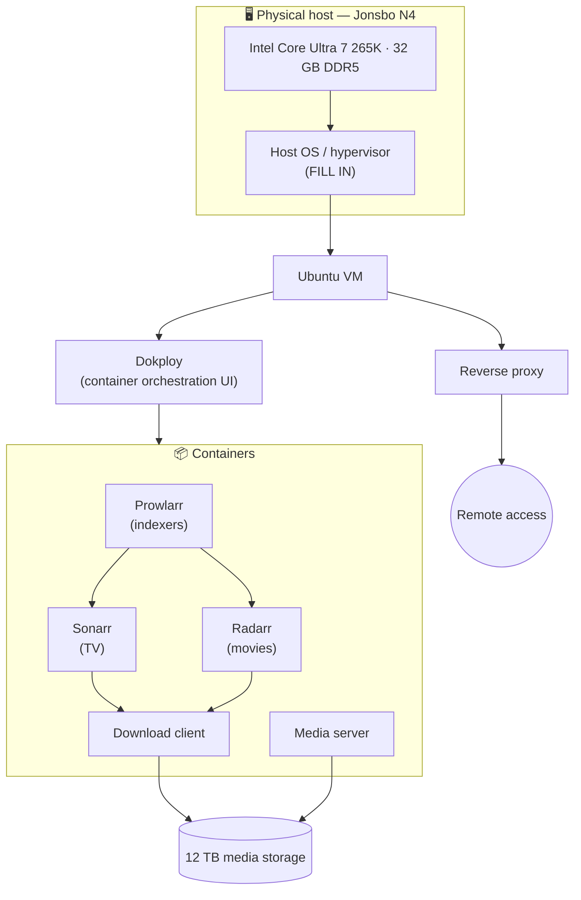
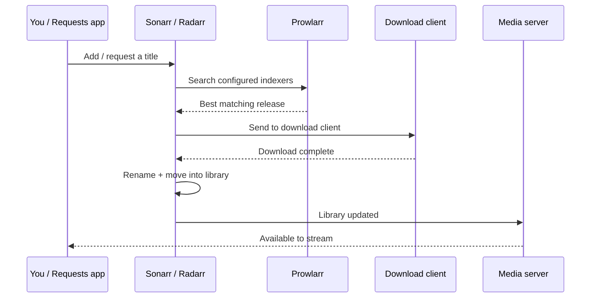

<div align="center">

# 🏠 Home Server

**A self-hosted home server running a media-automation stack and containerized apps via Dokploy.**

`Ubuntu` · `Docker` · `Dokploy` · `*arr stack` · `Jonsbo N4 NAS`

</div>

---

## 📖 Table of Contents

- [Overview](#-overview)
- [Architecture](#-architecture)
- [Hardware](#-hardware)
  - [System summary](#system-summary)
  - [Storage layout](#storage-layout)
- [Software stack](#-software-stack)
  - [Host & virtualization](#host--virtualization)
  - [Dokploy](#dokploy)
  - [Service inventory](#service-inventory)
- [The *arr* media stack](#-the-arr-media-stack)
  - [How the automation flows](#how-the-automation-flows)
- [Networking & remote access](#-networking--remote-access)
- [Storage & media library layout](#-storage--media-library-layout)
- [Backups & data safety](#-backups--data-safety)
- [Maintenance & operations](#-maintenance--operations)
- [Reproducing this build](#-reproducing-this-build)
- [Security checklist](#-security-checklist)

> [!NOTE]
> Sections tagged **`<!-- FILL IN -->`** are placeholders waiting on live data harvested from the server. Run the commands in [Maintenance & operations](#-maintenance--operations) and [Reproducing this build](#-reproducing-this-build), then drop the real values in.

---

## 🔭 Overview

This box does two jobs:

1. **Media automation** — a suite of self-hosted apps (the *"arr"* stack) that find, download, organize, and stream media automatically.
2. **App hosting** — an Ubuntu VM running [**Dokploy**](#dokploy), an open-source self-hostable platform that deploys and manages Docker apps and databases from a single dashboard (think a self-hosted Heroku/Vercel).

It lives in a compact [Jonsbo N4](#system-summary) NAS chassis with hot-swap drive bays, built around an Intel Core Ultra 7 platform.

---

## 🗺 Architecture



> Adjust the nodes once the [service inventory](#service-inventory) is filled from the live `docker ps` output.

---

## 🔩 Hardware

All component specs below are verified against manufacturer/retailer documentation.

### System summary

| Component | Spec | Notes |
|---|---|---|
| **CPU** | Intel Core Ultra 7 265K | 20 cores (8 P + 12 E), **20 threads — no Hyperthreading**. 3.9 GHz base / 5.5 GHz boost. LGA1851. 125 W base / 250 W max turbo. |
| **CPU cooler** | Noctua NH-L9x65 | Low-profile air cooler. LGA1851 supported. ⚠️ Rated ~95 W class — see [thermal note](#-a-note-on-cooling) below. |
| **Motherboard** | MSI PRO B860M-A WIFI | Intel B860 chipset, Micro-ATX, LGA1851. 4× DDR5 DIMM (up to 256 GB). Onboard 2.5 GbE + Wi-Fi. |
| **Memory** | G.Skill Ripjaws S5 32 GB (2×16 GB) | DDR5-5600, CL36. |
| **Boot / app storage** | Samsung 990 EVO Plus 1 TB | M.2-2280 NVMe. Hybrid **PCIe 4.0 ×4 / 5.0 ×2** (~7,150 MB/s ceiling — not a true Gen5 ×4 drive). |
| **Media storage** | 12 TB 3.5" HDD | Bulk media library. <!-- FILL IN: make/model, RPM, NAS-rated? --> |
| **Power supply** | Lian Li SP850 | 850 W, 80+ Gold, fully modular, **SFX** form factor. |
| **Case** | Jonsbo N4 | Micro-ATX NAS chassis. 6× 3.5" (4 hot-swap + 2 fixed) + 2× 2.5" = 8 bays. Takes SFX PSU. |
| **Case fan** | Noctua NF-A12x25 PWM chromax.black.swap | 120 mm. |

#### ⚠️ A note on cooling

The Noctua NH-L9x65 is a low-profile cooler designed for ~35–95 W SFF builds, while the Core Ultra 7 265K can pull up to **250 W** at full turbo. Under sustained multi-core load the CPU will reach throttling temperatures with this cooler. For a server workload, either:

- Cap **PL1/PL2 power limits** in BIOS (e.g. ~95–125 W) — recommended for a quiet, always-on box that doesn't need peak burst performance, **or**
- Move to a taller cooler if the chassis allows.

This is a heat-headroom trade-off, **not** a compatibility problem — the cooler fits the socket fine.

### Storage layout

<!-- FILL IN from `lsblk` / `df -hT` on the server -->

| Device | Size | Type | Role | Filesystem | Mountpoint |
|---|---|---|---|---|---|
| `nvme0n1` | 1 TB | NVMe SSD | OS + appdata / Docker volumes | `<FILL IN>` | `/` |
| `sda` | 12 TB | HDD | Media library | `<FILL IN>` | `<FILL IN>` |

---

## 💿 Software stack

### Host & virtualization

<!-- FILL IN -->

| Layer | Detail |
|---|---|
| Host OS / hypervisor | `<FILL IN — Proxmox / bare-metal Ubuntu / ESXi>` |
| Guest VM | Ubuntu `<version>` |
| Resources allocated | `<vCPU / RAM / disk assigned to the VM>` |
| Container runtime | Docker `<version>` |

> **Why a VM boundary?** Running Dokploy and the containers inside a dedicated Ubuntu VM isolates the workload from the host, makes snapshots/backups clean, and lets the host be rebuilt without touching the services. <!-- adjust if running bare-metal -->

### Dokploy

[**Dokploy**](https://dokploy.com) is an open-source, self-hostable PaaS. It runs on top of Docker and gives a web dashboard to deploy applications and databases, manage environment variables, wire up domains and TLS, and watch logs — without hand-writing Compose files for everything. It's the control plane for the app-hosting half of this server.

| | |
|---|---|
| Version | `<FILL IN>` |
| Dashboard URL | `<FILL IN — internal only>` |
| Manages | `<FILL IN — which apps/databases run under Dokploy vs. plain Compose>` |

### Service inventory

<!-- FILL IN from `docker ps` on the server. One row per container. -->

| Service | Purpose | Image | Internal port | Managed by |
|---|---|---|---|---|
| `<name>` | `<one-line blurb>` | `<image:tag>` | `<port>` | Dokploy / Compose |

---

## 🎬 The *arr* media stack

The *"arr"* apps are a family of self-hosted tools that automate the whole media pipeline. Each does one job and talks to the others. *(Keep only the ones you actually run; mark versions/URLs as internal.)*

| App | What it does (in plain language) |
|---|---|
| **Prowlarr** | Indexer manager — the single place you configure your trackers/indexers. It syncs them out to Sonarr, Radarr, etc., so you don't set them up app-by-app. |
| **Sonarr** | TV automation — monitors shows, grabs new episodes as they release, then renames and files them into your library. |
| **Radarr** | Same idea as Sonarr, but for movies. |
| **Lidarr** | Music automation. <!-- remove if not used --> |
| **Readarr** | Books / audiobooks automation. <!-- remove if not used --> |
| **Bazarr** | Finds and downloads subtitles for whatever Sonarr/Radarr have pulled in. |
| **Download client** | `<qBittorrent / SABnzbd>` — actually fetches the files the *arr* apps request. |
| **Media server** | `<Plex / Jellyfin / Emby>` — catalogs the library and streams it to your devices. |
| **Requests** | `<Overseerr / Jellyseerr>` — a friendly front-end where users request titles, which get handed to Sonarr/Radarr. <!-- remove if not used --> |

### How the automation flows



---

## 🌐 Networking & remote access

<!-- FILL IN — keep sensitive values out if this repo goes public; see Security checklist -->

| Item | Detail |
|---|---|
| LAN | 2.5 GbE (onboard) `<+ Wi-Fi?>` |
| Static IP / hostname | `<internal — consider omitting publicly>` |
| Reverse proxy | `<Traefik / Nginx Proxy Manager / Caddy>` |
| Domains / DNS | `<FILL IN>` |
| TLS / certificates | `<Let's Encrypt via … >` |
| Remote access | `<VPN — WireGuard/Tailscale / Cloudflare Tunnel>` |
| Internet-exposed services | `<list, or "none — VPN only">` |

---

## 🗂 Storage & media library layout

<!-- FILL IN -->

```text
/data
├── media
│   ├── movies
│   ├── tv
│   └── music
├── torrents      # active downloads
└── appdata       # per-container config
```

- **Hardlinks / atomic moves:** `<configured? — keeps imports instant and avoids double disk usage>`
- **Shares:** `<SMB / NFS exports, if any>`

---

## 💾 Backups & data safety

<!-- FILL IN — this is the "future-you" section -->

| What | Where | Frequency | Restore steps |
|---|---|---|---|
| Container configs / appdata | `<FILL IN>` | `<FILL IN>` | `<FILL IN>` |
| Dokploy state | `<FILL IN>` | `<FILL IN>` | `<FILL IN>` |
| VM snapshots | `<FILL IN>` | `<FILL IN>` | `<FILL IN>` |

> Media files themselves are typically **not** backed up (re-acquirable); configs and databases are what hurt to lose.

---

## 🛠 Maintenance & operations

**Harvest live system facts** (run on the server, then fill in the tables above):

```bash
# Hardware
lscpu                                              # CPU
free -h && sudo dmidecode -t memory                # RAM
sudo dmidecode -t baseboard -t bios                # motherboard / BIOS
lsblk -o NAME,SIZE,TYPE,MODEL,MOUNTPOINT && df -hT  # disks
lspci | grep -Ei 'vga|3d|nvidia|amd'               # GPU
ip -br addr                                         # network
cat /etc/os-release && uname -r                     # OS / kernel

# Software / services
docker ps --format 'table {{.Names}}\t{{.Image}}\t{{.Ports}}\t{{.Status}}'
docker compose ls
sudo ss -tlnp                                       # listening ports
```

**Routine tasks:**

- **Update containers:** `<FILL IN — Dokploy redeploy / docker compose pull && up -d / Watchtower>`
- **Restart a service:** `<FILL IN>`
- **Monitoring / dashboards:** `<FILL IN — Uptime Kuma / Grafana / Glances, if any>`
- **Common gotchas:** `<FILL IN>`

---

## 🧱 Reproducing this build

High-level steps to rebuild from scratch:

1. `<FILL IN — install host OS / hypervisor>`
2. `<FILL IN — create Ubuntu VM, install Docker>`
3. `<FILL IN — install Dokploy>`
4. `<FILL IN — deploy *arr stack + download client + media server>`
5. `<FILL IN — wire up reverse proxy, DNS, remote access>`
6. `<FILL IN — restore configs from backup>`

---

## 🔒 Security checklist

Run through this **before making the repo public**:

- [ ] No real public IPs / WAN addresses; internal IPs scrubbed if sensitive
- [ ] No real domain names / DDNS hostnames you don't want indexed
- [ ] No API keys, passwords, tokens, or `.env` contents (every *arr* app and Dokploy use API keys)
- [ ] No exact exposed-port → service mapping for anything internet-facing
- [ ] Screenshots cropped/redacted (usernames, library contents, IPs)
- [ ] `.gitignore` confirmed to exclude real compose/env files
- [ ] Media library examples are generic

---

<div align="center">
<sub>Self-hosted with ☕ and a Jonsbo N4.</sub>
</div>
