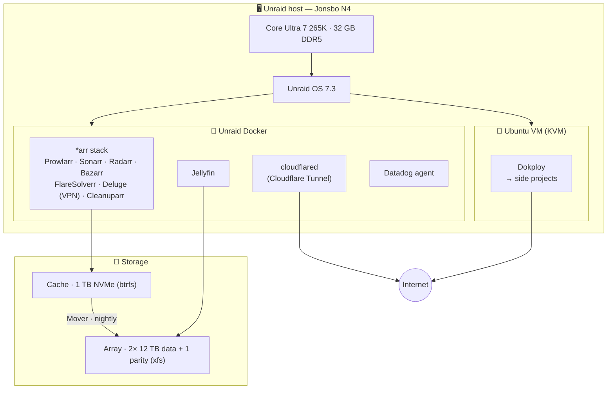
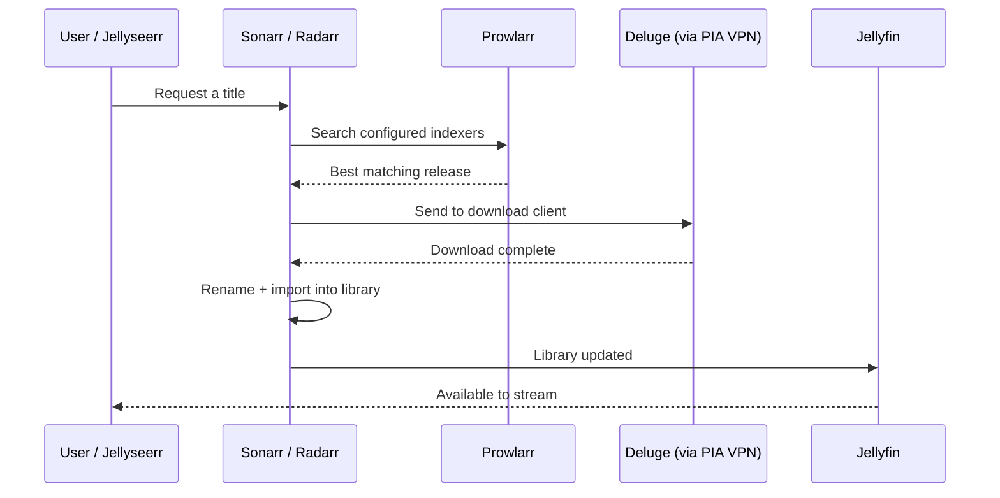

<div align="center">

# 🏠 Home Server

**A self-hosted Unraid home server: a media-automation stack, Cloudflare Tunnel + Tailscale networking, Datadog monitoring, and a Dokploy VM for side projects.**

`Unraid` · `Docker` · `*arr stack` · `Jellyfin` · `Dokploy` · `Datadog` · `Jonsbo N4 NAS`

</div>

---

## 📖 Table of Contents

- [Overview](#-overview)
- [Architecture](#-architecture)
- [Hardware](#-hardware)
  - [System summary](#system-summary)
  - [Cooling & airflow](#-cooling--airflow)
  - [Storage layout](#storage-layout)
- [Software stack](#-software-stack)
  - [Host & virtualization](#host--virtualization)
  - [Containers](#containers)
  - [Dokploy](#dokploy)
- [The *arr* media stack](#-the-arr-media-stack)
  - [How the automation flows](#how-the-automation-flows)
- [Networking & remote access](#-networking--remote-access)
- [Storage & media library layout](#-storage--media-library-layout)
- [Backups & data safety](#-backups--data-safety)
- [Maintenance & operations](#-maintenance--operations)
- [Reproducing this build](#-reproducing-this-build)
- [What's intentionally omitted](#-whats-intentionally-omitted)

---

## 🔭 Overview

The host runs **[Unraid OS](https://unraid.net)** (7.3) — a NAS/server OS built around a flexible, parity-protected storage array with first-class Docker and VM support. On top of it, the server does two jobs:

1. **Media automation + services** — the *"arr"* stack runs directly in **Unraid's Docker**, automatically finding, downloading, organizing, and streaming media through **Jellyfin**. A **`cloudflared`** container publishes selected services via Cloudflare Tunnel, **Tailscale** provides private remote admin, and a **Datadog agent** ships metrics and logs for monitoring.
2. **App hosting** — a single **Ubuntu VM** runs [**Dokploy**](#dokploy) (a self-hostable Heroku/Vercel), which deploys various personal side projects.

Storage is a **3× 12 TB** parity-protected Unraid array fronted by a 1 TB NVMe **cache** drive — writes land on the SSD and Unraid's **Mover** flushes them to the array nightly. Everything lives in a compact [Jonsbo N4](#system-summary) NAS chassis.

---

## 🗺 Architecture



---

## 🔩 Hardware

All component specs below are verified against manufacturer/retailer documentation and the live system.

### System summary

| Component | Spec | Notes |
|---|---|---|
| **CPU** | Intel Core Ultra 7 265K | 20 cores (8 P + 12 E), **20 threads — no Hyperthreading**. 3.9 GHz base / 5.5 GHz boost. LGA1851. 125 W base / 250 W max turbo. |
| **CPU cooler** | Noctua NH-L9x65 (Brown, 65 mm) | Premium low-profile air cooler. LGA1851 supported. CPU power-limited in BIOS to stay within its envelope — see [cooling & airflow](#-cooling--airflow). |
| **Motherboard** | MSI PRO B860M-A WIFI (MS-7E42) | Intel B860 chipset, Micro-ATX, LGA1851. 4× DDR5 DIMM (up to 256 GB). Onboard 2.5 GbE + Wi-Fi. |
| **Memory** | G.Skill Ripjaws S5 32 GB (2×16 GB) | DDR5-5600, CL36. ~30 GB visible to the OS after firmware/iGPU reservation. |
| **Cache drive** | Samsung 990 EVO Plus 1 TB | M.2-2280 NVMe. Hybrid **PCIe 4.0 ×4 / 5.0 ×2** (~7,150 MB/s ceiling). Unraid cache (btrfs): appdata + write landing zone. |
| **Storage array** | 3× 12 TB 3.5" HDD | Mixed NAS drives (Seagate IronWolf / IronWolf Pro + HGST Ultrastar). Unraid array: **1 parity + 2 data** (~24 TB usable, single-drive fault tolerance). |
| **Boot device** | USB flash (~119 GB) | Unraid boots from and is licensed to the USB stick. |
| **Power supply** | Lian Li SP850 | 850 W, 80+ Gold, fully modular, **SFX** form factor. |
| **Case** | Jonsbo N4 | Micro-ATX NAS chassis. 6× 3.5" (4 hot-swap + 2 fixed) + 2× 2.5" = 8 bays. Takes SFX PSU. ⚠️ Poor stock ventilation — see [airflow mod](#-cooling--airflow). |
| **Case fans** | Noctua NF-A12x25 PWM chromax.black.swap (120 mm)<br/>2× ARCTIC P12 Slim PWM PST (120 mm) | Slim front fans added via a 3D-printed adapter — see below. |

### ❄️ Cooling & airflow

This build had two cooling considerations, both addressed:

**1. CPU thermal envelope.** The Noctua NH-L9x65 is a low-profile cooler designed for ~35–95 W SFF builds, while the Core Ultra 7 265K can pull up to **250 W** at full turbo. To keep temperatures in check on an always-on server, the CPU is **power-limited (PL1/PL2) in BIOS** rather than left at stock turbo — a quiet-and-cool trade-off that gives up peak burst performance the server doesn't need. The cooler fits the LGA1851 socket fine; this is purely a heat-headroom choice.

**2. Case ventilation.** The Jonsbo N4 ships with minimal airflow — a single fan in the **bottom** of the chassis and no intake up front. To pull cool air across the drives and components, **two slim 120 mm fans (ARCTIC P12 Slim PWM PST)** were added to the **front**, mounted with a **3D-printed slim-fan front adapter** ([SLIM Fans Front Adapter for Jonsbo N4 on eBay](https://www.ebay.com/itm/406224064291)). The P12 Slim's extra-thin profile is what makes it fit the front of this case where a standard 25 mm fan wouldn't.

<div align="center">
  
  <br />
  <sub>The Jonsbo N4 (black, bottom) with its perforated front panel.</sub>
</div>

### Storage layout

Unraid pools the drives into a single parity-protected array with an SSD cache in front:

| Device | Drive | Size | Role | FS | Mounted as |
|---|---|---|---|---|---|
| Cache | Samsung 990 EVO Plus | 1 TB NVMe | appdata, Docker, VM image, write cache | btrfs | `/mnt/cache` |
| Parity | Seagate IronWolf | 12 TB | Parity — single-drive fault tolerance | — | — |
| Disk 1 | HGST Ultrastar | 12 TB | Array data | xfs | `/mnt/disk1` |
| Disk 2 | Seagate IronWolf Pro | 12 TB | Array data | xfs | `/mnt/disk2` |
| Boot | USB flash | ~119 GB | Unraid OS (boot + license) | vfat | — |
| User share | — | ~24 TB | Unified view spanning array + cache | — | `/mnt/user` |

- **Single parity:** the array tolerates **one** drive failure (a second parity slot exists but is unassigned).
- **Cache + Mover:** writes hit the NVMe cache first; the **Mover** flushes them to the array on a nightly schedule.

---

## 💿 Software stack

### Host & virtualization

| Layer | Detail |
|---|---|
| Host OS | **Unraid OS 7.3** (boots from USB) |
| Containers | Unraid's built-in **Docker** — runs the media stack, `cloudflared`, and the Datadog agent |
| Virtual machine | An **Ubuntu** VM (KVM) dedicated to Dokploy |

> **Why this split?** Unraid handles storage, Docker, and VMs natively, so the media stack runs as lightweight containers right on the host. Dokploy lives in its own Ubuntu VM so deploying and redeploying side projects can't destabilize the always-on media and storage services.

### Containers

Everything on Unraid Docker falls into three groups:

| Group | Containers | Role |
|---|---|---|
| **Media stack** | Prowlarr · Sonarr · Radarr · Bazarr · FlareSolverr · Deluge (VPN) · Cleanuparr · Jellyfin · Jellyseerr | Media automation + streaming — detailed in [the *arr* media stack](#-the-arr-media-stack) |
| **Networking** | `cloudflared` | Cloudflare Tunnel — publishes selected services with no open inbound ports (Tailscale handles admin — see [Networking](#-networking--remote-access)) |
| **Monitoring** | Datadog agent | Host + container metrics and logs shipped to Datadog |

The Ubuntu VM runs **Dokploy**, which in turn hosts various personal side projects (see [Dokploy](#dokploy)).

### Dokploy

[**Dokploy**](https://dokploy.com) is an open-source, self-hostable PaaS. It runs on top of Docker and gives a web dashboard to deploy applications and databases, manage environment variables, wire up domains and TLS, and watch logs — without hand-writing Compose files for everything. It's the control plane for the app-hosting half of this server.

| | |
|---|---|
| Runs on | Ubuntu VM (KVM) on the Unraid host |
| Role | Deploys and manages various personal side projects (websites, an Obsidian sync server, and other small apps) |

---

## 🎬 The *arr* media stack

A family of self-hosted tools that each do one job and hand off to the next, automating the whole pipeline from request to stream:

| App | Container / image | What it does (in plain language) |
|---|---|---|
| **Prowlarr** | `binhex/arch-prowlarr` | Indexer manager — the single place to configure trackers/indexers; syncs them out to Sonarr & Radarr so you don't set them up app-by-app. |
| **Sonarr** | `binhex/arch-sonarr` | TV automation — monitors shows, grabs new episodes as they release, then renames and files them into the library. |
| **Radarr** | `binhex/arch-radarr` | Same idea as Sonarr, but for movies. |
| **Bazarr** | `linuxserver/bazarr` | Finds and downloads subtitles for whatever Sonarr/Radarr pull in. |
| **FlareSolverr** | `binhex/arch-flaresolverr` | Proxy that solves Cloudflare / CAPTCHA challenges so indexers stay reachable. |
| **Deluge (+ VPN)** | `binhex/arch-delugevpn` | The BitTorrent download client. Its traffic is routed through a **built-in PIA VPN** — everything is tunneled, and downloads stop rather than leak if the VPN drops. |
| **Cleanuparr** | `cleanuparr/cleanuparr` | Housekeeping for the queue — auto-removes stalled, failed, or orphaned downloads (and blocklists bad releases) so the *arr* apps keep retrying cleanly. |
| **Jellyfin** | `jellyfin/jellyfin` | Open-source media server — catalogs the library and streams it to your devices. |
| **Jellyseerr** | `fallenbagel/jellyseerr` | Request front-end — a friendly UI where users request titles, which get handed to Sonarr/Radarr. |

> Most *arr* apps use [**binhex**](https://github.com/binhex) image variants; Bazarr uses [**LinuxServer**](https://www.linuxserver.io/).

### How the automation flows



---

## 🌐 Networking & remote access

| Item | Detail |
|---|---|
| LAN | 2.5 GbE onboard, bonded |
| Published services | **Cloudflare Tunnel** via a `cloudflared` container — selected services are reachable externally with **no inbound ports opened** on the router |
| Remote admin | **Tailscale** — a private mesh VPN for administering the box remotely |
| TLS / certificates | Terminated at Cloudflare's edge |

> Specific IPs, domains, and tunnel hostnames are deliberately kept out of this public repo — see [What's intentionally omitted](#-whats-intentionally-omitted).

---

## 🗂 Storage & media library layout

Unraid exposes everything through **user shares** (`/mnt/user/...`) that span the cache and the array. A representative layout:

```text
/mnt/user
├── media/        # movies, tv — served by Jellyfin from the array
├── downloads/    # active downloads — kept on cache for speed
├── appdata/      # per-container config — kept on cache
└── system/       # docker.img / libvirt.img
```

- **Cache + Mover:** writes land on the 1 TB NVMe cache for speed; Unraid's **Mover** flushes media to the parity-protected array on a nightly schedule. `appdata` and active downloads stay cache-resident.
- **Hardlinks / atomic moves:** the download and media paths live inside the **same Unraid user share** so imports are instant hardlinks instead of slow cross-share copies.

---

## 💾 Backups & data safety

Unraid **parity** protects the array against a single-drive failure — but parity is not a backup, and the data that actually hurts to lose is configuration, not media:

- **`appdata` (container configs):** the per-container settings for the whole media stack, backed up so the stack can be rebuilt without reconfiguring each app from scratch.
- **Dokploy state:** the VM and its deployment configuration.
- **Media files** are intentionally **not** backed up — they're re-acquirable, and backing up tens of terabytes isn't practical.

---

## 🛠 Maintenance & operations

Most day-to-day management happens in the **Unraid web UI** (Dashboard, Main, Docker, and VMs tabs). The commands below harvest the same facts over SSH for documentation.

```bash
# Hardware (run on the Unraid host)
lscpu                                              # CPU
free -h                                            # RAM
lsblk -o NAME,SIZE,TYPE,MODEL,MOUNTPOINT           # disks
cat /etc/unraid-version && uname -r                # Unraid + kernel

# Containers (Unraid host)
docker ps --format 'table {{.Names}}\t{{.Image}}\t{{.Status}}'
```

**Routine tasks:**

- **Update containers:** Unraid **Docker** tab → check for updates / apply (host services); **Dokploy** redeploy for VM-hosted side projects.
- **Array / Mover:** the Mover runs nightly on a schedule (Settings → Scheduler); parity checks run on Unraid's schedule.
- **Monitoring:** **Datadog** (agent container) for metrics and logs, plus the built-in Unraid Dashboard.

---

## 🧱 Reproducing this build

High-level steps to rebuild from scratch:

1. Flash **Unraid** to a USB stick, boot, apply the license, and configure the array: assign **1 parity + 2 data** 12 TB drives and the 1 TB NVMe as **cache** (btrfs).
2. Enable Docker; install the media stack (**Prowlarr, Sonarr, Radarr, Bazarr, FlareSolverr, Deluge+VPN, Cleanuparr, Jellyfin, Jellyseerr**), `cloudflared`, and the **Datadog agent** via Unraid Community Apps.
3. Set up the **Cloudflare Tunnel** (publish services) and **Tailscale** (remote admin).
4. Create the **Ubuntu VM** (KVM); install Docker + **Dokploy**.
5. Redeploy side projects through the Dokploy dashboard.
6. Restore `appdata` and Dokploy state from backup.

---

## 🔒 What's intentionally omitted

This repo is public, so anything that would help someone reach or attack the server is deliberately left out:

- Public/WAN and internal LAN IP addresses; Tailscale addresses
- Domain names and the hostnames routed through the Cloudflare Tunnel
- API keys, passwords, tokens, and `.env` contents (every *arr* app, Deluge/PIA, Dokploy, and the Datadog agent use them)
- Exact port mappings for anything reachable from outside
- Personal Unraid share names

`.gitignore` excludes real env/compose files so secrets can't be committed by accident.

---

<div align="center">
<sub>Self-hosted with ☕ and a Jonsbo N4.</sub>
</div>
