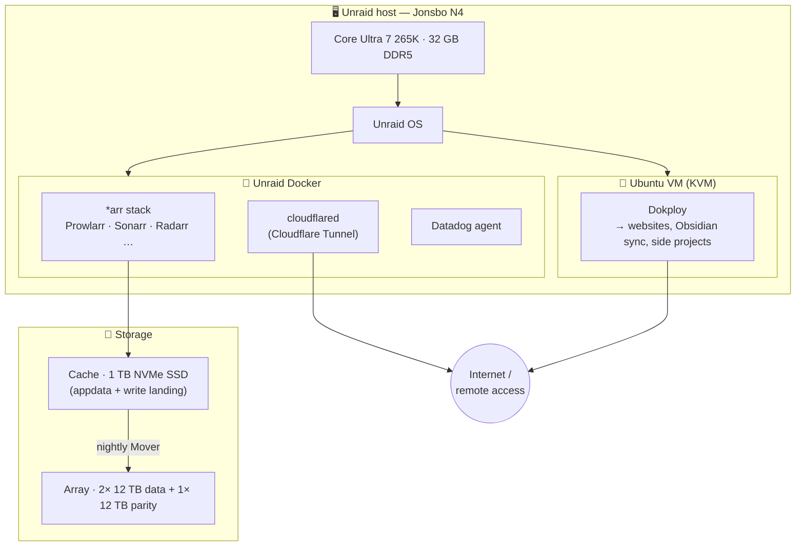
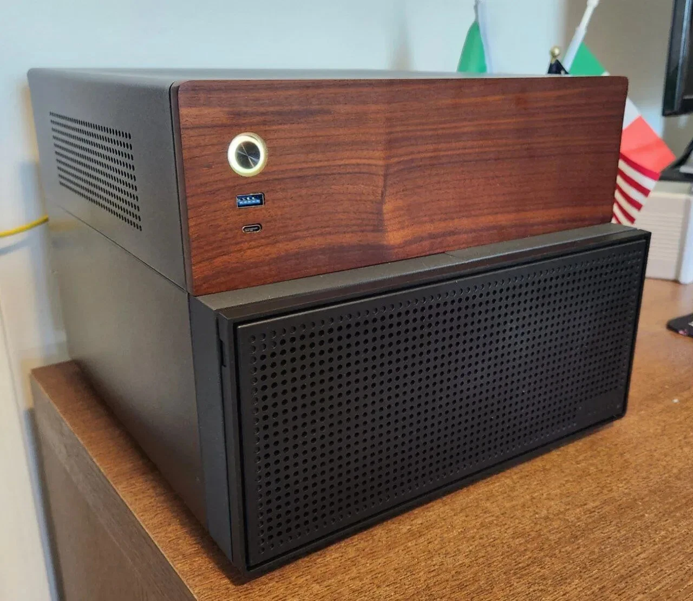
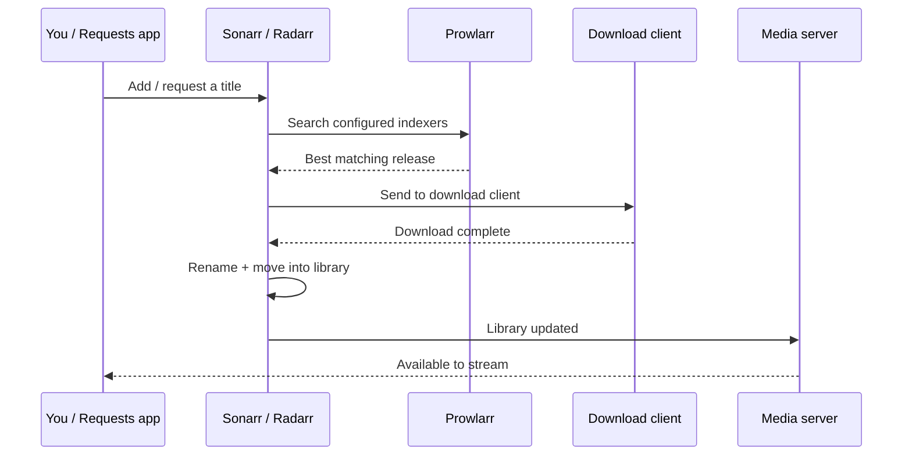

<div align="center">

# 🏠 Home Server

**A self-hosted home server running a media-automation stack and containerized apps via Dokploy.**

`Ubuntu` · `Docker` · `Dokploy` · `*arr stack` · `Jonsbo N4 NAS`

</div>

---

## 📖 Table of Contents

- [Overview](#-overview)
- [Architecture](#-architecture)
- [Hardware](#-hardware)
  - [System summary](#system-summary)
  - [Storage layout](#storage-layout)
- [Software stack](#-software-stack)
  - [Host & virtualization](#host--virtualization)
  - [Dokploy](#dokploy)
  - [Service inventory](#service-inventory)
- [The *arr* media stack](#-the-arr-media-stack)
  - [How the automation flows](#how-the-automation-flows)
- [Networking & remote access](#-networking--remote-access)
- [Storage & media library layout](#-storage--media-library-layout)
- [Backups & data safety](#-backups--data-safety)
- [Maintenance & operations](#-maintenance--operations)
- [Reproducing this build](#-reproducing-this-build)
- [Security checklist](#-security-checklist)

> [!NOTE]
> Sections tagged **`<!-- FILL IN -->`** are placeholders waiting on live data harvested from the server. Run the commands in [Maintenance & operations](#-maintenance--operations) and [Reproducing this build](#-reproducing-this-build), then drop the real values in.

---

## 🔭 Overview

The host runs **[Unraid OS](https://unraid.net)** — a NAS/server OS built around a flexible, parity-protected storage array with first-class Docker and VM support. On top of it, the server does two jobs:

1. **Media automation + services** — the *"arr"* stack runs directly in **Unraid's Docker**, automatically finding, downloading, organizing, and streaming media. Alongside it, a **`cloudflared`** container provides the reverse proxy / remote access via Cloudflare Tunnel, and a **Datadog agent** container handles monitoring.
2. **App hosting** — a single **Ubuntu VM** runs [**Dokploy**](#dokploy) (a self-hostable Heroku/Vercel), which deploys side projects: websites, an Obsidian sync server, and similar.

Storage is a **3× 12 TB** parity-protected Unraid array fronted by a 1 TB NVMe **cache** drive — writes land on the SSD and Unraid's **Mover** flushes them to the array nightly. Everything lives in a compact [Jonsbo N4](#system-summary) NAS chassis.

---

## 🗺 Architecture



> Service names get finalized once the [service inventory](#service-inventory) is filled from the live Unraid Docker list.

---

## 🔩 Hardware

All component specs below are verified against manufacturer/retailer documentation.

### System summary

| Component | Spec | Notes |
|---|---|---|
| **CPU** | Intel Core Ultra 7 265K | 20 cores (8 P + 12 E), **20 threads — no Hyperthreading**. 3.9 GHz base / 5.5 GHz boost. LGA1851. 125 W base / 250 W max turbo. |
| **CPU cooler** | Noctua NH-L9x65 (Brown, 65 mm) | Premium low-profile air cooler. LGA1851 supported. CPU power-limited in BIOS to stay within its envelope — see [cooling & airflow](#-cooling--airflow) below. |
| **Motherboard** | MSI PRO B860M-A WIFI | Intel B860 chipset, Micro-ATX, LGA1851. 4× DDR5 DIMM (up to 256 GB). Onboard 2.5 GbE + Wi-Fi. |
| **Memory** | G.Skill Ripjaws S5 32 GB (2×16 GB) | DDR5-5600, CL36. |
| **Cache drive** | Samsung 990 EVO Plus 1 TB | M.2-2280 NVMe. Hybrid **PCIe 4.0 ×4 / 5.0 ×2** (~7,150 MB/s ceiling). Unraid cache: appdata + write landing zone, flushed to the array nightly. |
| **Storage array** | 3× 12 TB 3.5" HDD | Unraid array: **1 parity + 2 data** (~24 TB usable, single-drive fault tolerance). <!-- FILL IN: make/model, RPM, NAS-rated? --> |
| **Boot device** | USB flash drive | Unraid boots from and is licensed to a USB stick. <!-- FILL IN: capacity/model (optional) --> |
| **Power supply** | Lian Li SP850 | 850 W, 80+ Gold, fully modular, **SFX** form factor. |
| **Case** | Jonsbo N4 | Micro-ATX NAS chassis. 6× 3.5" (4 hot-swap + 2 fixed) + 2× 2.5" = 8 bays. Takes SFX PSU. ⚠️ Poor stock ventilation — see [airflow mod](#-cooling--airflow). |
| **Case fans** | Noctua NF-A12x25 PWM chromax.black.swap (120 mm)<br/>2× ARCTIC P12 Slim PWM PST (120 mm) | Slim front fans added via a 3D-printed adapter — see below. |

### ❄️ Cooling & airflow

This build had two cooling considerations, both addressed:

**1. CPU thermal envelope.** The Noctua NH-L9x65 is a low-profile cooler designed for ~35–95 W SFF builds, while the Core Ultra 7 265K can pull up to **250 W** at full turbo. To keep temperatures in check on an always-on server, the CPU is **power-limited (PL1/PL2) in BIOS** rather than left at stock turbo — a quiet-and-cool trade-off that gives up peak burst performance the server doesn't need. The cooler fits the LGA1851 socket fine; this is purely a heat-headroom choice.

**2. Case ventilation.** The Jonsbo N4 ships with minimal airflow — a single fan in the **bottom** of the chassis and no intake up front. To pull cool air across the drives and components, **two slim 120 mm fans (ARCTIC P12 Slim PWM PST)** were added to the **front**, mounted with a **3D-printed slim-fan front adapter** ([SLIM Fans Front Adapter for Jonsbo N4 on eBay](https://www.ebay.com/itm/406224064291)). The P12 Slim's extra-thin profile is what makes it fit the front of this case where a standard 25 mm fan wouldn't.

<div align="center">
  
  <br />
  <sub>The Jonsbo N4 (black, bottom) with its perforated front panel.</sub>
</div>

### Storage layout

Unraid pools the drives into a single parity-protected array with an SSD cache in front:

| Device | Size | Type | Role | Mounted as |
|---|---|---|---|---|
| Cache | 1 TB | NVMe SSD | appdata, Docker, VM image, write cache | `/mnt/cache` |
| Parity | 12 TB | HDD | Parity — fault tolerance, no usable capacity | — |
| Disk 1 | 12 TB | HDD | Array data | `/mnt/disk1` |
| Disk 2 | 12 TB | HDD | Array data | `/mnt/disk2` |
| User share | ~24 TB | — | Unified view spanning array + cache | `/mnt/user` |

---

## 💿 Software stack

### Host & virtualization

| Layer | Detail |
|---|---|
| Host OS | **Unraid OS** `<version — FILL IN>` (boots from USB) |
| Containers | Unraid's built-in **Docker** — runs the *arr* stack, `cloudflared`, and the Datadog agent |
| Virtual machine | **Ubuntu** `<version — FILL IN>` VM (KVM), dedicated to Dokploy |
| VM resources | `<vCPU / RAM / disk assigned — FILL IN>` |

> **Why this split?** Unraid handles storage, Docker, and VMs natively, so the media stack runs as lightweight containers right on the host. Dokploy lives in its own Ubuntu VM so deploying and redeploying side projects can't destabilize the always-on media and storage services.

### Dokploy

[**Dokploy**](https://dokploy.com) is an open-source, self-hostable PaaS. It runs on top of Docker and gives a web dashboard to deploy applications and databases, manage environment variables, wire up domains and TLS, and watch logs — without hand-writing Compose files for everything. It's the control plane for the app-hosting half of this server.

| | |
|---|---|
| Runs on | Ubuntu VM (KVM) on the Unraid host |
| Version | `<FILL IN>` |
| Dashboard URL | `<FILL IN — internal only>` |
| Deploys | Side projects — websites, an Obsidian sync server, and other small apps `<FILL IN: list>` |

### Service inventory

**On Unraid Docker** (always-on host services):

| Service | Purpose | Image | Notes |
|---|---|---|---|
| *arr stack | Media automation — see [the *arr* stack](#-the-arr-media-stack) | — | `<FILL IN: versions>` |
| `<download client>` | Fetches releases the *arr* apps request | `<FILL IN>` | qBittorrent / SABnzbd |
| `<media server>` | Catalogs + streams the library | `<FILL IN>` | Plex / Jellyfin / Emby |
| `cloudflared` | Cloudflare Tunnel — reverse proxy + remote access with no open inbound ports | `cloudflare/cloudflared` | see [Networking](#-networking--remote-access) |
| Datadog agent | Metrics, logs, and container/host monitoring | `gcr.io/datadoghq/agent` | `<FILL IN: confirm image>` |

> Fill the exact container names, images, and tags from the harvest output.

**On the Ubuntu VM, via Dokploy** (side-project deployments):

| Deployment | Purpose |
|---|---|
| Obsidian sync server | Self-hosted sync for Obsidian notes |
| `<websites / other side projects>` | `<FILL IN>` |

---

## 🎬 The *arr* media stack

The *"arr"* apps are a family of self-hosted tools that automate the whole media pipeline. Each does one job and talks to the others. *(Keep only the ones you actually run; mark versions/URLs as internal.)*

| App | What it does (in plain language) |
|---|---|
| **Prowlarr** | Indexer manager — the single place you configure your trackers/indexers. It syncs them out to Sonarr, Radarr, etc., so you don't set them up app-by-app. |
| **Sonarr** | TV automation — monitors shows, grabs new episodes as they release, then renames and files them into your library. |
| **Radarr** | Same idea as Sonarr, but for movies. |
| **Lidarr** | Music automation. <!-- remove if not used --> |
| **Readarr** | Books / audiobooks automation. <!-- remove if not used --> |
| **Bazarr** | Finds and downloads subtitles for whatever Sonarr/Radarr have pulled in. |
| **Download client** | `<qBittorrent / SABnzbd>` — actually fetches the files the *arr* apps request. |
| **Media server** | `<Plex / Jellyfin / Emby>` — catalogs the library and streams it to your devices. |
| **Requests** | `<Overseerr / Jellyseerr>` — a friendly front-end where users request titles, which get handed to Sonarr/Radarr. <!-- remove if not used --> |

### How the automation flows



---

## 🌐 Networking & remote access

<!-- FILL IN — keep sensitive values out if this repo goes public; see Security checklist -->

| Item | Detail |
|---|---|
| LAN | 2.5 GbE (onboard) |
| Reverse proxy / remote access | **Cloudflare Tunnel** via a `cloudflared` container — exposes selected services without opening any inbound ports on the router |
| Domains / DNS | Cloudflare `<FILL IN — domain(s)>` |
| TLS / certificates | Terminated at Cloudflare's edge |
| Internet-exposed services | `<FILL IN — which hostnames are routed through the tunnel>` |

---

## 🗂 Storage & media library layout

Unraid exposes everything through **user shares** (`/mnt/user/...`) that span the cache and the array:

```text
/mnt/user
├── media/        # movies, tv, music — flushed to the array
├── downloads/    # active downloads — kept on cache for speed
└── appdata/      # per-container config — kept on cache
```

- **Cache + Mover:** writes land on the 1 TB NVMe cache for speed; Unraid's **Mover** flushes `media/` to the parity-protected array on a nightly schedule. `appdata/` and `downloads/` are typically kept cache-only.
- **Hardlinks / atomic moves:** keep the download and media paths inside the **same Unraid user share** so imports are instant hardlinks instead of slow cross-share copies.
- **Shares:** `<SMB / NFS exports, if any — FILL IN>`

---

## 💾 Backups & data safety

<!-- FILL IN — this is the "future-you" section -->

| What | Where | Frequency | Restore steps |
|---|---|---|---|
| Container configs / appdata | `<FILL IN>` | `<FILL IN>` | `<FILL IN>` |
| Dokploy state | `<FILL IN>` | `<FILL IN>` | `<FILL IN>` |
| VM snapshots | `<FILL IN>` | `<FILL IN>` | `<FILL IN>` |

> Media files themselves are typically **not** backed up (re-acquirable); configs and databases are what hurt to lose.

---

## 🛠 Maintenance & operations

Most day-to-day management happens in the **Unraid web UI** (Dashboard, Main, Docker, and VMs tabs). The commands below harvest the same facts over SSH for documentation.

```bash
# Hardware (run on the Unraid host)
lscpu                                              # CPU
free -h                                             # RAM
lsblk -o NAME,SIZE,TYPE,MODEL,MOUNTPOINT            # disks
cat /etc/unraid-version && uname -r                 # Unraid + kernel

# Containers (Unraid host)
docker ps --format 'table {{.Names}}\t{{.Image}}\t{{.Status}}'
```

**Routine tasks:**

- **Update containers:** Unraid **Docker** tab → check for updates / apply (host services); **Dokploy** redeploy for VM-hosted side projects.
- **Array / Mover:** Mover runs nightly on a schedule (Settings → Scheduler); parity checks run on Unraid's schedule.
- **Monitoring / dashboards:** **Datadog** (agent container on Unraid) plus the built-in Unraid Dashboard. `<FILL IN — Datadog dashboard link(s) if any>`
- **Common gotchas:** `<FILL IN>`

---

## 🧱 Reproducing this build

High-level steps to rebuild from scratch:

1. Flash **Unraid** to a USB stick, boot, apply the license, and configure the array: assign **1 parity + 2 data** 12 TB drives and the 1 TB NVMe as **cache**.
2. Enable Docker; install the **\*arr stack**, download client, media server, `cloudflared`, and the **Datadog agent** (via Unraid Community Apps).
3. Set up the **Cloudflare Tunnel** and route the chosen hostnames through `cloudflared`.
4. Create the **Ubuntu VM** (KVM); install Docker + **Dokploy**.
5. Redeploy side projects (websites, Obsidian sync, …) through the Dokploy dashboard.
6. Restore `appdata` and Dokploy state from backup.

---

## 🔒 Security checklist

Run through this **before making the repo public**:

- [ ] No real public IPs / WAN addresses; internal IPs scrubbed if sensitive
- [ ] No real domain names / DDNS hostnames you don't want indexed
- [ ] No API keys, passwords, tokens, or `.env` contents (every *arr* app and Dokploy use API keys)
- [ ] No exact exposed-port → service mapping for anything internet-facing
- [ ] Screenshots cropped/redacted (usernames, library contents, IPs)
- [ ] `.gitignore` confirmed to exclude real compose/env files
- [ ] Media library examples are generic

---

<div align="center">
<sub>Self-hosted with ☕ and a Jonsbo N4.</sub>
</div>
